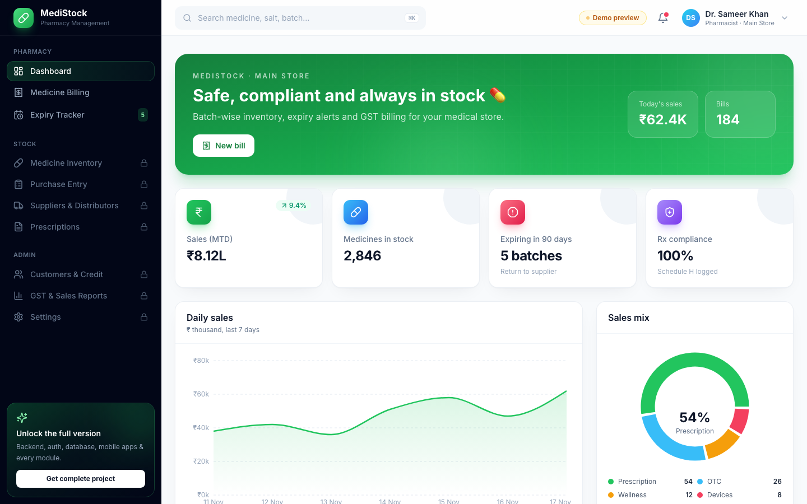
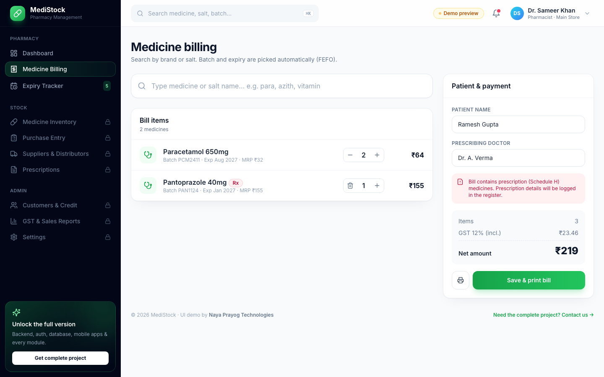
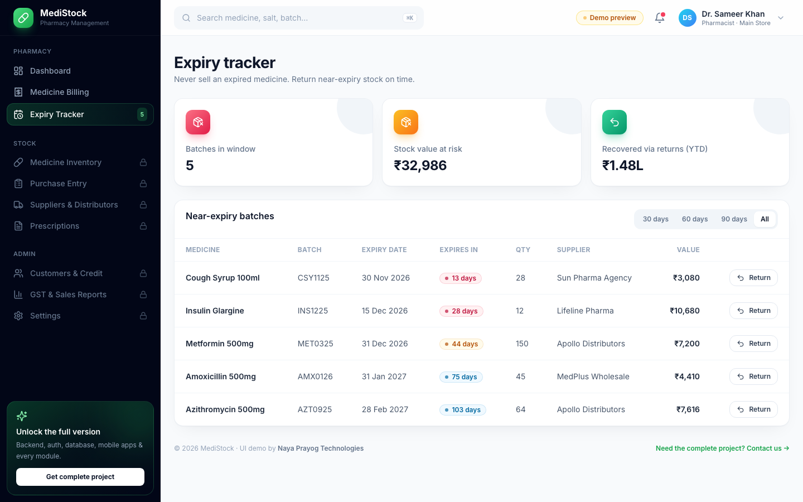

# Pharmacy Management Software | Pharmacy Billing, Inventory & POS System

Simplify pharmacy operations with custom **Pharmacy Management Software** developed by **Naya Prayog Technologies**.

We provide pharmacy software development services for medical stores, retail pharmacies, wholesale medicine distributors, pharmacy chains, and healthcare businesses.

A modern pharmacy management system can help manage medicine inventory, purchase records, sales, billing, suppliers, stock expiry, customer information, and business reports from a centralized platform.

Whether you operate a single medical store or manage multiple pharmacy outlets, we can develop a pharmacy management solution around your business requirements.

**Looking for Pharmacy Management Software Development?**

Let's discuss your project.

- Website: https://nayaprayog.com/
- Email: support@nayaprayog.com
- Phone / WhatsApp: +91 7991327022
- Direct WhatsApp: https://wa.me/917991327022
- Portfolio: https://github.helloharendra.io

---

<!-- screenshots -->
## Screenshots

**Dashboard**

<table>
  <tr>
    <td align="center" width="50%"><b>Billing</b>  </td>
    <td align="center" width="50%"><b>Expiry</b>  </td>
  </tr>
</table>

---

## What Is Pharmacy Management Software?

Pharmacy Management Software is a digital business management system designed to organize and automate the daily operations of a pharmacy or medical store.

It can connect different business activities, including:

- Medicine inventory management
- Pharmacy billing and POS
- Medicine purchase management
- Sales and returns
- Supplier management
- Batch and expiry tracking
- Customer management
- GST and tax-related records
- Financial reports
- Multi-store management

The objective is to reduce manual work, improve stock visibility, organize transactions, and support better business decisions.

---

## Pharmacy Management Software Development Services

We develop custom pharmacy software solutions with modules based on your business workflows and operational requirements.

### 1. Pharmacy Billing and POS Software

A pharmacy billing system can simplify medicine sales and invoice generation.

Potential features:

- Fast medicine billing
- Barcode scanning integration
- Medicine search
- Product and quantity selection
- Batch selection
- Discount management
- Tax calculation
- Multiple payment methods
- Invoice generation and printing
- Sales return and refund workflows
- Daily sales summaries

### 2. Medicine Inventory Management

Manage medicine stock and maintain better visibility into available inventory.

Potential features:

- Medicine catalog management
- Product categories
- Batch-wise stock management
- Purchase and stock entries
- Stock adjustments
- Low-stock alerts
- Expiry-date tracking
- Stock transfer between branches
- Inventory valuation
- Stock movement history

### 3. Medicine Purchase Management

Organize medicine purchasing and supplier transactions.

Potential features:

- Supplier management
- Purchase order creation
- Purchase invoice recording
- Medicine purchase entries
- Batch and expiry information
- Purchase return management
- Supplier payment records
- Purchase history
- Outstanding supplier balances

### 4. Expiry and Batch Management

Medicine expiry and batch tracking are important pharmacy operations.

Potential capabilities:

- Batch-wise medicine records
- Manufacturing and expiry dates
- Near-expiry stock reports
- Expired stock identification
- Batch-wise inventory
- Purchase and sales traceability
- Expiry-related alerts
- Stock adjustment workflows

### 5. Supplier and Customer Management

Manage pharmacy relationships and transaction records in one place.

Potential features:

- Supplier profiles
- Customer profiles
- Contact information
- Purchase history
- Sales history
- Outstanding balances
- Payment records
- Customer transaction reports

### 6. GST and Financial Management

Develop financial workflows that help pharmacy businesses organize their sales and purchase records.

Potential capabilities:

- Configurable tax calculations
- GST invoice formats
- Sales reports
- Purchase reports
- Payment tracking
- Cash and digital payment records
- Expense management
- Profit and loss reporting
- Financial summaries

Tax configuration and statutory reporting should be validated against applicable accounting and tax requirements.

### 7. Multi-Branch Pharmacy Management

For businesses operating multiple medical stores, a centralized platform can help coordinate operations.

Potential features:

- Multiple pharmacy branches
- Branch-wise inventory
- Centralized administration
- Branch-level billing
- Stock transfers
- Branch-wise sales reports
- User and staff management
- Centralized business analytics

### 8. Pharmacy Admin Dashboard

A web-based administration dashboard can provide centralized control over pharmacy operations.

Potential capabilities:

- Medicine and category management
- Inventory monitoring
- Purchase management
- Sales monitoring
- Supplier management
- Staff and user management
- Financial summaries
- Reports and analytics
- System configuration
- Role-based access control

---

## Core Modules of a Pharmacy Management System

| Module | Business Purpose |
|---|---|
| POS Billing | Process medicine sales and generate invoices |
| Inventory Management | Track available medicine stock |
| Purchase Management | Record purchases from suppliers |
| Supplier Management | Manage supplier information and transactions |
| Batch Management | Maintain batch-wise stock records |
| Expiry Management | Identify near-expiry and expired stock |
| Sales Management | Monitor daily and historical sales |
| Returns Management | Record purchase and sales returns |
| Customer Management | Organize customer information |
| GST and Tax Records | Maintain configurable tax-related transactions |
| Reports and Analytics | Understand business performance |
| User Management | Manage staff access and permissions |

The modules can be selected and customized according to the pharmacy's requirements.

---

## Who Needs Pharmacy Management Software?

Our pharmacy software development services are suitable for:

- Independent medical stores
- Retail pharmacies
- Wholesale medicine distributors
- Pharmacy chains
- Hospital pharmacies
- Online pharmacy businesses
- Multi-branch medical stores
- Healthcare retailers
- Pharmacy startups

---

## Pharmacy Software: Desktop, Web and Mobile Solutions

Depending on your business model, we can develop pharmacy management solutions for different platforms.

**Web-Based Pharmacy Software**

Access pharmacy operations through a browser with a centralized backend and administration dashboard.

**Desktop Pharmacy Billing Software**

Build desktop-oriented billing workflows for pharmacy counters and local store operations, depending on the deployment requirements.

**Mobile Pharmacy Management App**

Manage selected business operations through Android and iOS applications.

**Cloud-Based Pharmacy Management**

Support centralized access to business information across authorized locations and devices.

The final platform architecture depends on connectivity, hardware, synchronization, security, and operational requirements.

---

## Benefits of Pharmacy Management Software

A well-designed pharmacy management system can help businesses:

- Reduce manual billing and record-keeping
- Improve medicine stock visibility
- Monitor batch numbers and expiry dates
- Organize supplier purchases
- Track sales and returns
- Improve inventory control
- Maintain structured financial records
- Generate useful business reports
- Manage multiple pharmacy branches
- Improve daily operational efficiency

---

## Why Choose Naya Prayog Technologies?

**Custom Pharmacy Software Development**

We develop software based on your pharmacy's actual business processes and requirements.

**Business-Oriented Architecture**

We plan modules around billing, inventory, purchasing, sales, and reporting workflows.

**Multi-Platform Development**

Solutions can include web applications, desktop-oriented systems, and Android or iOS applications.

**Integration Capabilities**

Integrate supported barcode scanners, printers, payment gateways, and other third-party services where required.

**Scalable Solutions**

Plan for future expansion, additional branches, users, products, and operational modules.

**End-to-End Software Development**

We can assist with requirement analysis, UI/UX design, development, testing, deployment, and ongoing maintenance.

---

## Technology Stack

Technology selection depends on project requirements and deployment architecture.

Potential technologies include:

- **Mobile Development:** Flutter, Android, iOS
- **Frontend:** React, Next.js
- **Backend:** Node.js, REST APIs
- **Database:** MySQL, PostgreSQL, MongoDB, Firebase
- **Cloud and Deployment:** VPS and cloud infrastructure
- **Integrations:** Barcode scanners, receipt printers, payment gateways, and third-party APIs

---

## Security and Data Management

Pharmacy software can contain customer information, sales transactions, prescription-related records, and other business-sensitive data.

Depending on the application scope, development may include:

- Secure user authentication
- Role-based access control
- Protected API endpoints
- Secure data transmission
- Database access controls
- Transaction history
- Audit logs
- Backup and recovery planning
- Secure handling of prescription-related information

Security and data protection requirements should be assessed according to the application and applicable regulations.

---

## Pharmacy Management Software Development Process

1. **Business Analysis** – Understand your pharmacy operations, billing workflow, inventory, and reporting requirements.
2. **Module Planning** – Define billing, purchases, inventory, expiry tracking, and other required modules.
3. **UI/UX Design** – Design practical interfaces for pharmacy owners, cashiers, and administrators.
4. **Software Development** – Develop the frontend, backend, database, and required applications.
5. **Hardware and API Integration** – Integrate supported printers, barcode scanners, payment systems, and APIs.
6. **Testing** – Validate billing calculations, stock movements, reports, and user workflows.
7. **Deployment** – Deploy the agreed solution and configure the required environment.
8. **Maintenance** – Support updates, improvements, and future business requirements as agreed.

---

## Frequently Asked Questions

### What is pharmacy management software?

Pharmacy management software is a business application used to manage medicine inventory, billing, purchases, suppliers, sales, expiry tracking, and other pharmacy operations.

### Can you develop pharmacy billing software?

Yes. We can develop custom pharmacy billing and POS software with medicine search, batch selection, barcode scanning integration, discounts, configurable taxes, invoice generation, and sales reports.

### Can pharmacy software manage medicine expiry dates?

Yes. Batch-wise inventory and expiry management workflows can be included to identify near-expiry and expired medicine stock.

### Can you develop software for multiple pharmacy branches?

Yes. Multi-branch pharmacy management can include centralized administration, branch-wise stock, stock transfers, sales monitoring, and consolidated reporting.

### Can you integrate barcode scanners and receipt printers?

Supported barcode scanners, receipt printers, and other pharmacy counter hardware can be integrated according to device compatibility and technical requirements.

### Can you develop cloud-based pharmacy software?

Yes. We can develop cloud-based solutions that allow authorized users to access pharmacy operations from supported devices and locations.

### Can you customize existing pharmacy software?

We can assess your existing software, available source code, APIs, and business requirements to determine whether customization or a new solution is the better approach.

### How much does pharmacy management software development cost?

Pricing depends on the number of modules, platforms, hardware integrations, users, branches, and deployment requirements. Contact us to discuss your project and receive an estimate.

---

## Build Your Custom Pharmacy Management System

Looking for pharmacy billing software, medicine inventory management, medical store POS software, or a complete pharmacy management system?

**Naya Prayog Technologies** helps businesses develop custom software solutions that support their operational and growth requirements.

**Discuss Your Pharmacy Software Project**

- Website: https://nayaprayog.com/
- Email: support@nayaprayog.com
- Phone / WhatsApp: +91 7991327022
- Direct WhatsApp: https://wa.me/917991327022
- Portfolio: https://github.helloharendra.io

**Naya Prayog Technologies**  
Custom Software Development | POS and Billing Software | Business Automation | Healthcare Technology

---

## Repository Information

This repository is a service and portfolio showcase for pharmacy management software development by Naya Prayog Technologies.

The features described above represent potential development capabilities and solution modules. They should not be interpreted as confirmation that every feature is implemented in a ready-to-use application.

**Proprietary Notice:** This repository is a project showcase. No permission to redistribute, reuse, or commercially exploit proprietary source code, branding, or materials is granted unless separately authorized in writing.
